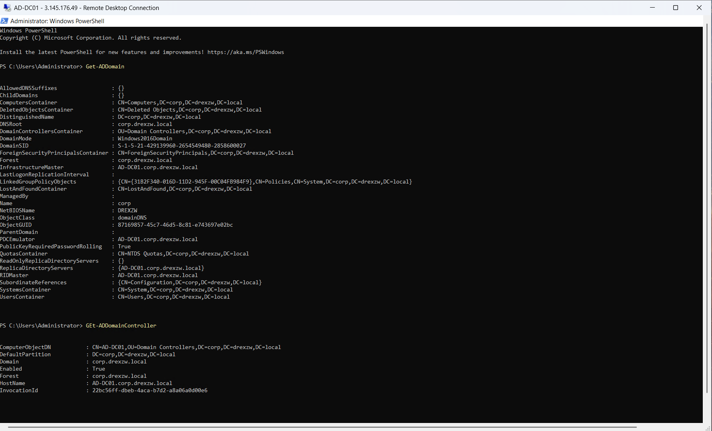
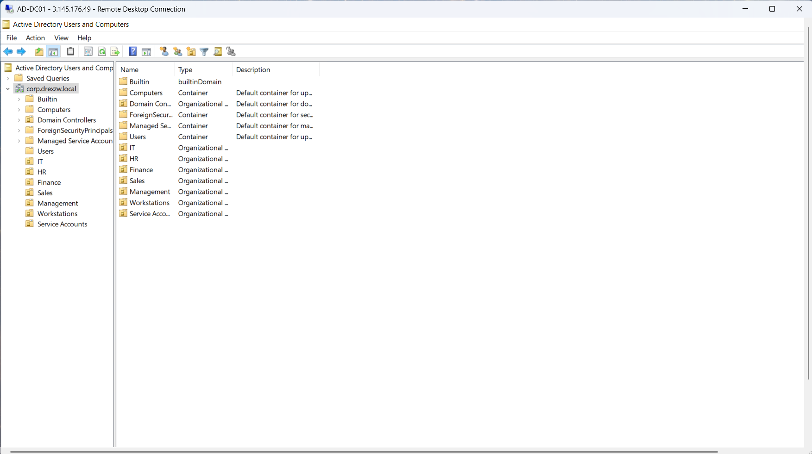
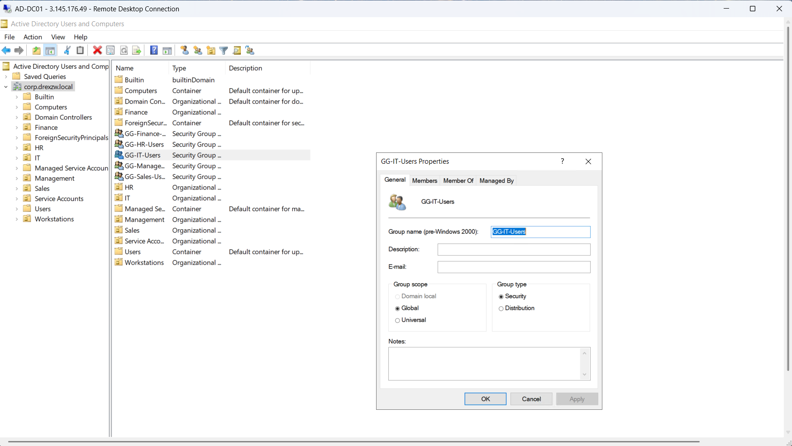
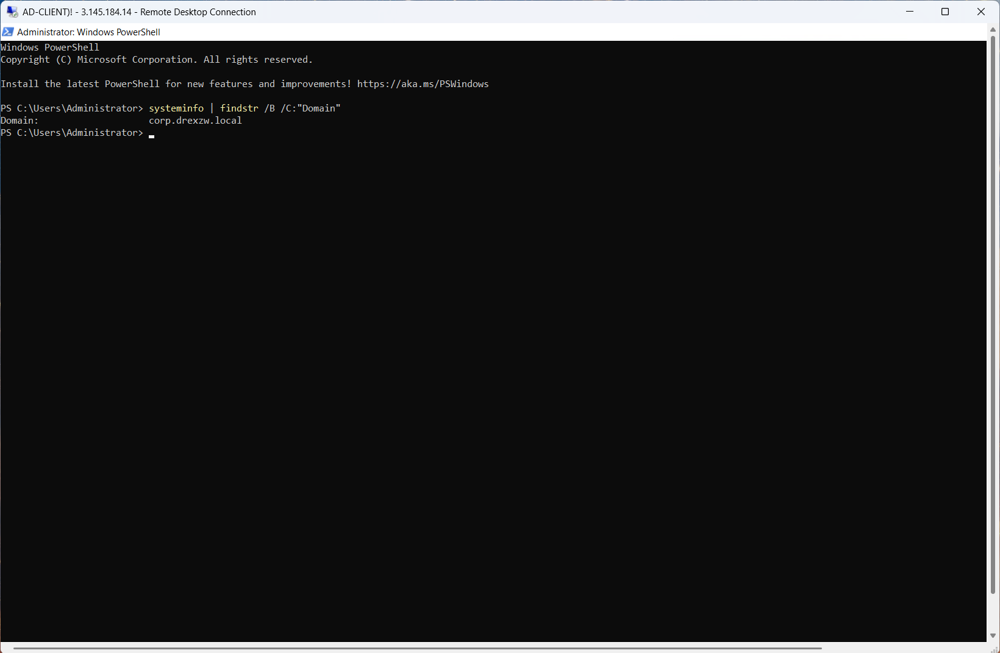
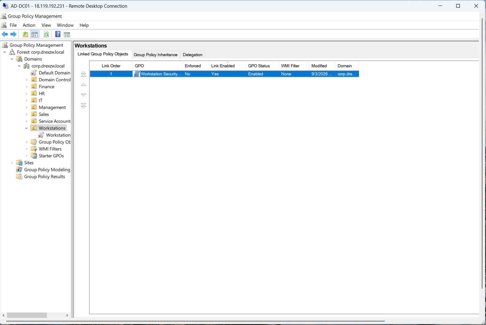
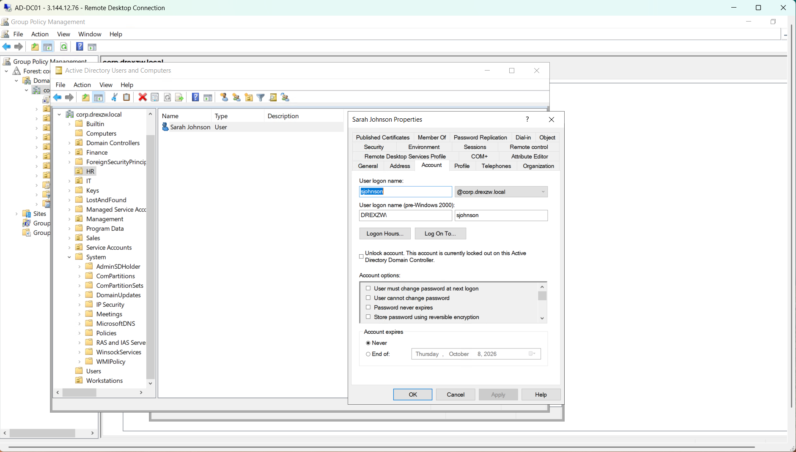
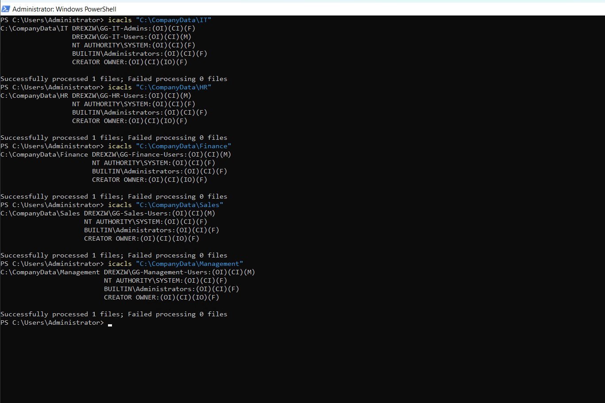
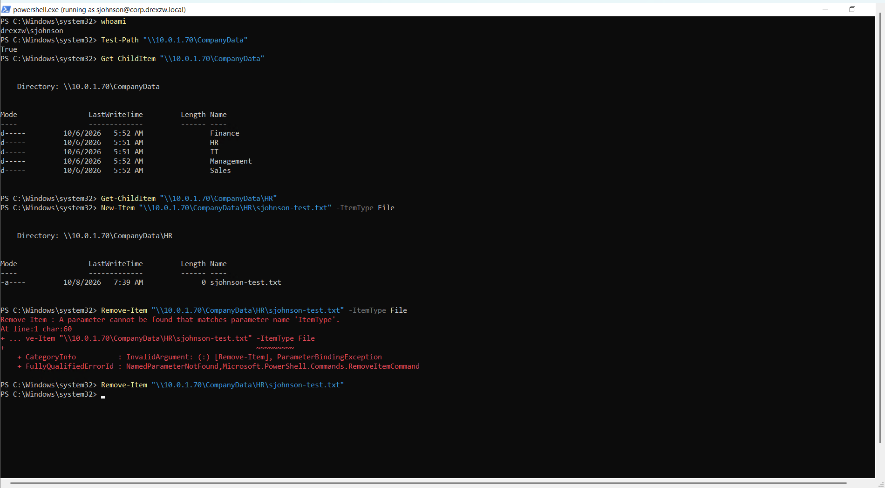
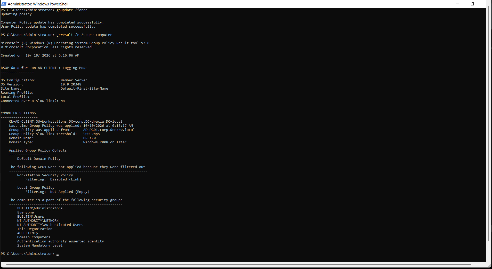
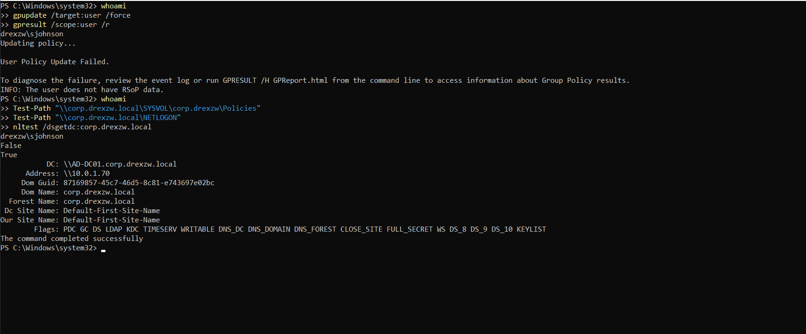

# Active Directory Lab — Windows Server 2022

A hands-on Active Directory lab that simulates a small business Windows domain. It was built to practice the day-to-day work of an IT Support / Help Desk technician: setting up users and groups, controlling access to files, and troubleshooting problems from both the client and the server side.

> **Environment:** personal lab on AWS EC2 · **Domain:** `corp.drexzw.local` (NetBIOS name: `DREXZW`)
> This is a lab, not a production network. Where something was not tested or not captured in a screenshot, the documentation says so.

---

## What this lab shows

| Skill | Where to see it |
| --- | --- |
| Building a domain: AD DS, DNS, OUs, users, security groups | [Build stages 1–3](#build-stages) |
| Joining a client to the domain and verifying it from both sides | [Stage 4](#4-client-domain-join) |
| Group Policy: creating, linking and verifying a GPO | [Stage 5](#5-group-policy) |
| Account lockout: reproduce, confirm, unlock, verify | [INC-AD-001](tickets/account-lockout-sarah-johnson.md) |
| Department folder permissions with `icacls`, including an inheritance problem found during review | [Stage 7](#7-department-folder-permissions-ntfs) |
| Shared folder access: share permissions versus NTFS permissions | [INC-AD-002](tickets/shared-folder-access-sarah-johnson.md) |
| Group Policy not applying: reading `gpresult` to find a disabled link | [INC-AD-003](tickets/group-policy-not-applying.md) |
| A drive-mapping GPO that is still not working, written up as an open case | [INC-AD-004](tickets/gpo-drive-mapping-not-applying.md), [Stage 10](#10-department-drive-mapping-inc-ad-004-unresolved) |
| Writing tickets with a root cause, a fix and a verification step | INC-AD-001 to 003 |
| Writing up an unresolved problem honestly: what was checked, what was found, what is unknown | INC-AD-004 |

## Help Desk tickets

INC-AD-001 to INC-AD-003 are simulated incidents: the fault was introduced on purpose so the troubleshooting could be practiced and documented. INC-AD-004 is different. It is a real failure met while building drive mapping, and it is **still unresolved**.

| ID | Symptom | Root cause | Tools used |
| --- | --- | --- | --- |
| [INC-AD-001](tickets/account-lockout-sarah-johnson.md) | "I can't sign in. My account is locked." | Failed sign-ins exceeded the lockout threshold (5 attempts) | ADUC, Group Policy Management, `runas`, `whoami` |
| [INC-AD-002](tickets/shared-folder-access-sarah-johnson.md) | "I can open the HR folder but can't save a file." | Share permission was Read; NTFS allowed Modify; the stricter one wins | `whoami`, `Get-ADGroupMember`, `icacls`, `Get-SmbShareAccess`, `Grant-SmbShareAccess` |
| [INC-AD-003](tickets/group-policy-not-applying.md) | "The workstation is missing its security policy." | The GPO's link to the Workstations OU was disabled | `gpupdate /force`, `gpresult /r`, Group Policy Management |
| [INC-AD-004](tickets/gpo-drive-mapping-not-applying.md) (unresolved) | "My department drive did not map." | Not determined. The user policy refresh fails with an access-denied error (`0x5`) | `gpupdate`, `gpresult`, `nltest`, `Get-WinEvent`, Group Policy Management |

More detail on every problem hit during the lab, including the ones that were not full tickets, is in [`troubleshooting.md`](troubleshooting.md).

---

## Lab environment

| Component | Details |
| --- | --- |
| Domain Controller | `AD-DC01`, Windows Server 2022: AD DS, DNS, Group Policy, and the SMB share |
| Client | `AD-CLIENT`, a domain-joined computer in the Workstations OU. `gpresult` reports it as `OS Configuration: Member Server`, build `10.0.20348` (the Windows Server 2022 build number), so it is a server-edition machine acting as the client |
| Hosting | AWS EC2 |
| Domain | `corp.drexzw.local` (NetBIOS: `DREXZW`) |

```text
corp.drexzw.local
├── AD-DC01      Domain Controller: AD DS, DNS, Group Policy, SMB share (CompanyData)
└── AD-CLIENT    Domain-joined computer, in the Workstations OU

OUs:     IT, HR, Finance, Sales, Management, Service Accounts, Workstations
Groups:  GG-IT-Users, GG-IT-Admins, GG-HR-Users, GG-Finance-Users,
         GG-Sales-Users, GG-Management-Users
Users:   jsmith (IT), sjohnson (HR), mbrown (Finance), dwilson (Sales), rdavis (Management)
GPOs:    Default Domain Policy, Workstation Security Policy, Department Drive Maps
```

---

## Build stages

Each stage below shows one key screenshot. All 56 screenshots are in [`screenshots/`](screenshots/), grouped by stage in the order the work was done.

### 1. Domain Controller

A Windows Server 2022 EC2 instance was configured as the Domain Controller. AD DS was installed and the result was checked with PowerShell.



*`Get-ADDomain` and `Get-ADDomainController` on `AD-DC01`: domain `corp.drexzw.local`, NetBIOS name `DREXZW`.*

More: [`screenshots/01-domain-controller/`](screenshots/01-domain-controller/)

### 2. Organizational Units

Seven OUs were created: IT, HR, Finance, Sales, Management, Service Accounts and Workstations. The Workstations OU was checked while empty, then again after the client joined, to confirm the computer object landed in the right place.



*Active Directory Users and Computers: the OUs under `corp.drexzw.local`.*

More: [`screenshots/02-active-directory-structure/`](screenshots/02-active-directory-structure/)

### 3. Users and groups

One global security group per department (`GG-<Dept>-Users`), plus `GG-IT-Admins` for administrative access to the IT folder. Permissions are given to groups, not to individual users, so a change in access becomes a change in group membership. In this lab the groups were created in the domain root, next to the OUs.



*`GG-IT-Users` properties: group scope Global, group type Security.*

More: [`screenshots/03-users-and-groups/`](screenshots/03-users-and-groups/)

### 4. Client domain join

The client's DNS was pointed at the Domain Controller, the client was joined to the domain, and a domain user signed in. The join was then checked again from the Domain Controller with `Get-ADComputer`.



*On `AD-CLIENT`, `systeminfo` reports `Domain: corp.drexzw.local`.*

More: [`screenshots/04-client-domain-join/`](screenshots/04-client-domain-join/)

### 5. Group Policy

A GPO named **Workstation Security Policy** was created and linked to the Workstations OU.



*Group Policy Management: Workstation Security Policy linked to the Workstations OU (`Enforced: No`, `Link Enabled: Yes`, `GPO Status: Enabled`).*

Two accuracy notes:

* **Password settings.** This GPO contains password settings ([screenshot](screenshots/05-group-policy/02-password-policy-settings.png)). Account Policy settings in a GPO linked to an OU only affect *local* accounts on the computers in that OU. The password and lockout rules that govern *domain* accounts come from the Default Domain Policy. That is where the lockout ticket reads its settings from. The effect of the OU-linked password settings was not tested.
* **Where policy application was checked.** [`05-group-policy/03`](screenshots/05-group-policy/03-gpo-application-verification.png) was run on the Domain Controller, so it shows the Domain Controller's policies, not this GPO. Application of Workstation Security Policy on the client is shown in INC-AD-003.

### 6. Account lockout (INC-AD-001)

A lockout was reproduced with repeated `runas` attempts and a wrong password, confirmed in ADUC, fixed with the **Unlock account** checkbox, and verified with `runas` and `whoami`. The ticket also lists what a technician would check in production before simply unlocking, such as stale saved credentials or mapped drives.



*ADUC, Account tab: the account is currently locked out.*

Full ticket: [INC-AD-001](tickets/account-lockout-sarah-johnson.md)

### 7. Department folder permissions (NTFS)

Department folders were created under `C:\CompanyData`, and each group was given Modify on its own folder (`GG-IT-Admins` also has Full Control on the IT folder). All grants were made with `icacls`.

Reading the ACLs after the grants showed a problem: every department folder still carried inherited `BUILTIN\Users` entries. Each grant had succeeded, but the inherited entries would likely have weakened the separation between departments. The fix was to disable inheritance on each folder and then remove `BUILTIN\Users`. This was found by reading the ACLs. It was not reproduced from a client session.



*`icacls` after the cleanup: each folder lists only its department group, SYSTEM, Administrators and CREATOR OWNER. No `BUILTIN\Users`, no inherited `(I)` entries.*

More: [`screenshots/07-department-permissions/`](screenshots/07-department-permissions/). The first set of `icacls` commands failed because the wrong domain prefix was used (`CORP\` instead of `DREXZW\`). That failed attempt was not captured (**not pictured**); see [`troubleshooting.md`](troubleshooting.md).

### 8. SMB share and shared-folder ticket (INC-AD-002)

The department folders were shared as `CompanyData` over SMB. A user whose NTFS permission was correct still could not save a file, because the share permission was Read. Over the network the more restrictive of the two layers applies. The fix was to change the group's share permission to Change.



*Retest as `sjohnson`: the file is created in `\\10.0.1.70\CompanyData\HR`. The red error is an unrelated `Remove-Item` syntax mistake.*

Full ticket: [INC-AD-002](tickets/shared-folder-access-sarah-johnson.md)

### 9. Group Policy not applying (INC-AD-003)

The link between Workstation Security Policy and the Workstations OU was disabled on purpose. After `gpupdate /force`, `gpresult` showed why the policy was missing, and re-enabling the link fixed it.



*`gpresult /r /scope computer` on `AD-CLIENT`: Workstation Security Policy is filtered out with `Disabled (Link)`.*

Full ticket: [INC-AD-003](tickets/group-policy-not-applying.md)

### 10. Department drive mapping (INC-AD-004, unresolved)

A Group Policy Preferences GPO, **Department Drive Maps**, was built to map a drive for each department from `\\AD-DC01\CompanyData` when its users sign in (`H:` HR, `I:` IT, `F:` Finance, `S:` Sales, `M:` Management). It did not work, and it is not fixed. The user policy refresh for `sjohnson` fails with `User Policy Update Failed.`, and the Group Policy event log records access-denied errors (error code `0x5`).



*`gpupdate /target:user /force` fails for `sjohnson` while `nltest` still finds the Domain Controller.*

What is established, and what is not:

* **Established:** DNS works, the Domain Controller can be found by domain name, and the HR share can be reached by its network path. The failure is in user policy processing.
* **Not established:** the cause. A GPO permission finding (Read access without Apply Group Policy) is a lead, but it was not captured in a screenshot and was not confirmed by a fix and retest. SYSVOL access by domain name was not confirmed either.
* **Not achieved:** no mapped drive was ever captured.

Full ticket: [INC-AD-004](tickets/gpo-drive-mapping-not-applying.md)

---

## Limits of this lab

* One client computer and one Domain Controller. The share is hosted on the Domain Controller, which is a lab simplification.
* Only `GG-HR-Users` was given Change on the share, and access was tested from the client only as `sjohnson` (HR). Cross-department access from a client was not tested.
* Group Policy results in INC-AD-003 are computer-scope, from one computer, run as the local `Administrator`. The settings inside the GPO were not re-tested.
* In INC-AD-002 and INC-AD-003, one screenshot each was captured out of order or after the fix. The ticket evidence notes say which.
* INC-AD-004 is unresolved. The Department Drive Maps GPO has not been shown to apply, no mapped drive was captured, and its screenshots are numbered in investigation order, not capture order.
* Commands marked "not run" in the tickets are reference only and are not shown in any screenshot.

## Status

This lab is ongoing and will continue to grow. New work is added as separate, documented stages and tickets, built on the existing domain. Department drive mapping is documented as it stands: investigated, not yet fixed.

## Files

| File | Purpose |
| --- | --- |
| [`tickets/`](tickets/) | The four Help Desk tickets: three resolved, each with a root cause, fix and verification, and one open investigation (INC-AD-004) |
| [`troubleshooting.md`](troubleshooting.md) | Every problem hit during the lab, with the lesson from each |
| [`commands.md`](commands.md) | Command reference |
| [`screenshots/`](screenshots/) | All 56 screenshots, in ten numbered stage folders |
