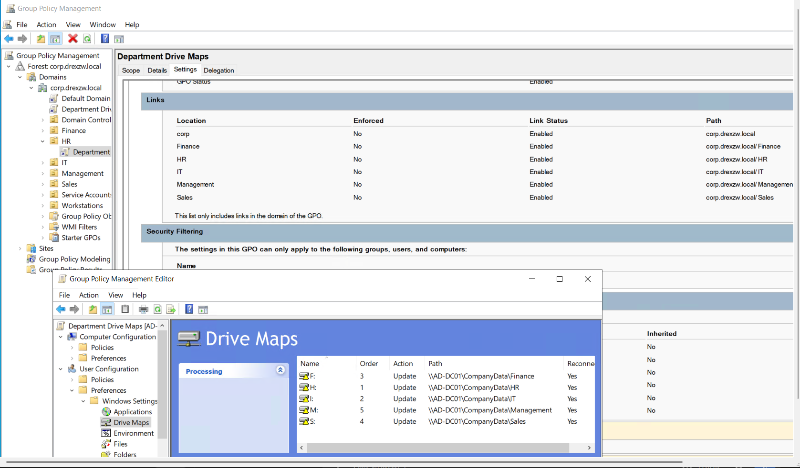
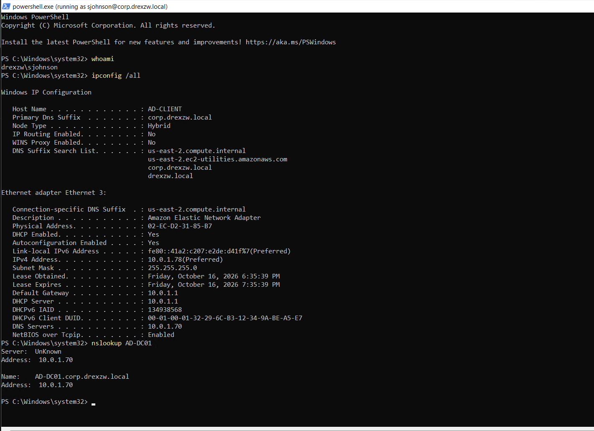
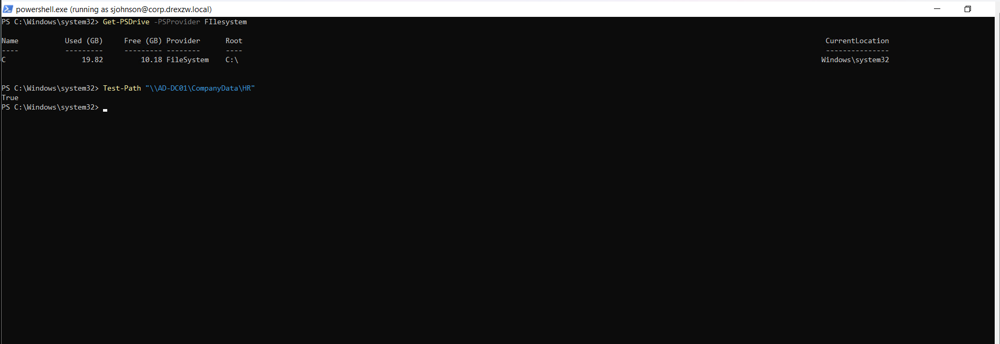
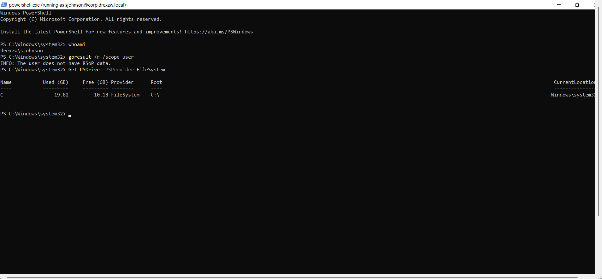
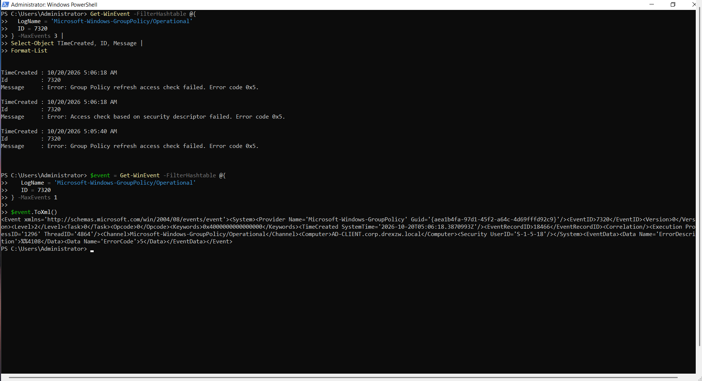
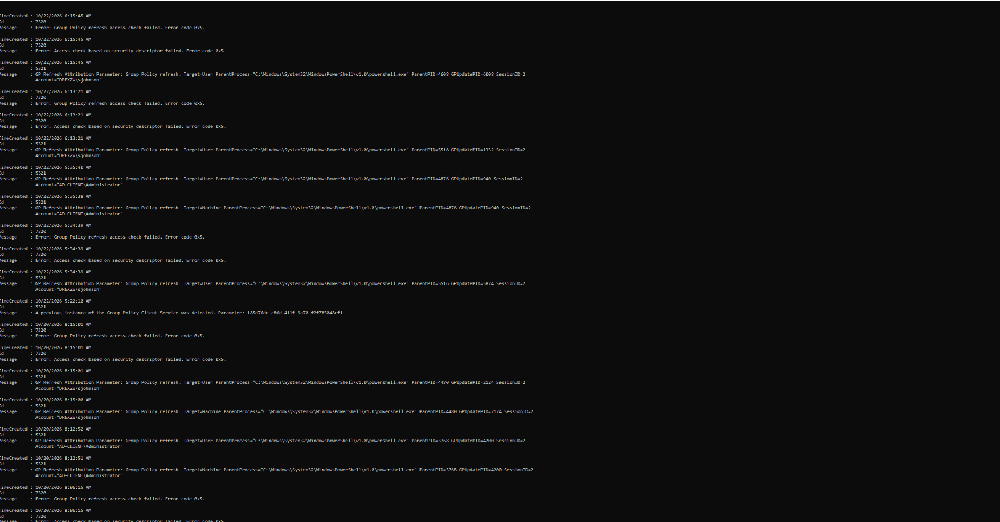

# Help Desk Ticket — Department Drive Maps Not Applying

**Ticket ID:** INC-AD-004
**Status:** Unresolved — investigation paused
**Priority:** Medium
**Category:** Group Policy / Drive Mapping
**Environment:** Active Directory Lab
**Domain:** `corp.drexzw.local` (NetBIOS: `DREXZW`)
**Domain Controller:** `AD-DC01`
**Affected Computer:** `AD-CLIENT`
**Affected User:** Sarah Johnson (`sjohnson`, HR)
**Group Policy Object:** Department Drive Maps
**Technician:** IT Support Lab
**Date:** October 2026 (investigated over several days)

---

## 1. Reported Issue

The departmental network drives did not appear for the test user, and the user's Group Policy refresh failed.

> **Lab note:** Unlike INC-AD-001 to INC-AD-003, this fault was not introduced on purpose. It appeared while building drive mapping, and it is **not resolved**. This ticket records what was checked, what was found, and what is still unknown. It does not claim a fix.

---

## 2. Intended Design

One Group Policy Preferences GPO, **Department Drive Maps**, was meant to map a drive for each department when its users sign in. The settings are under User Configuration > Preferences > Windows Settings > Drive Maps. All five items use `Action: Update` and `Reconnect: Yes`, and the GPO is linked to the domain and to each department OU.

| Department | Drive | Path |
| --- | --- | --- |
| HR | `H:` | `\\AD-DC01\CompanyData\HR` |
| IT | `I:` | `\\AD-DC01\CompanyData\IT` |
| Finance | `F:` | `\\AD-DC01\CompanyData\Finance` |
| Sales | `S:` | `\\AD-DC01\CompanyData\Sales` |
| Management | `M:` | `\\AD-DC01\CompanyData\Management` |



*Department Drive Maps: links enabled on the domain and the five department OUs, and the five drive items with their paths.*

Not pictured: how each drive was limited to its own department, and the GPO's Security Filtering list and permissions (part of that window is covered by the editor window in this screenshot).

---

## 3. Initial Assessment

A drive map from Group Policy depends on several layers, so the first job was to separate them:

* **Identity and DNS:** can the client find the domain and the Domain Controller?
* **File access:** can the user reach the share, through both share and NTFS permissions?
* **Group Policy:** is the GPO in scope for the user, and does the user's policy refresh complete?

Reaching the share does not prove Group Policy will map it, so the file-access and Group Policy checks were done separately.

---

## 4. Troubleshooting

### Step 1 — Baseline: identity and DNS

On `AD-CLIENT`, from a PowerShell window running as `sjohnson`:

```powershell
whoami
ipconfig /all
nslookup AD-DC01
```

`whoami` returned `drexzw\sjohnson`. The Primary DNS Suffix is `corp.drexzw.local` and the DNS server is `10.0.1.70`. `nslookup AD-DC01` resolved to `AD-DC01.corp.drexzw.local` at `10.0.1.70`. The `Server: UnKnown` line only means that address has no reverse lookup name; the lookup itself worked.



*Baseline: signed in as `sjohnson`, client DNS points at the Domain Controller, `AD-DC01` resolves.*

---

### Step 2 — Baseline: the share is reachable without Group Policy

```powershell
Get-PSDrive -PSProvider FileSystem
Test-Path "\\AD-DC01\CompanyData\HR"
```

Only `C:` was listed, and `Test-Path` returned `True`, so the HR folder can be reached by its network path as `sjohnson`. Group membership and the share and NTFS permissions for HR were verified earlier, in [INC-AD-002](shared-folder-access-sarah-johnson.md) ([`08-smb-share-access/02`](../screenshots/08-smb-share-access/02-hr-group-membership-and-ntfs-verified.png)).



*Baseline: the HR share is reachable by UNC path. This is a baseline, not failure evidence (see Evidence Notes).*

---

### Step 3 — First symptom: no user policy data, no mapped drives

```powershell
gpresult /r /scope user
Get-PSDrive -PSProvider FileSystem
```

`gpresult` reported `INFO: The user does not have RSoP data.` and the only drive listed was still `C:`.



*First failure evidence: no resultant-policy data for `sjohnson`, and no mapped drive.*

---

### Step 4 — Force a user policy refresh and check the Domain Controller

```powershell
gpupdate /target:user /force
gpresult /scope:user /r
Test-Path "\\corp.drexzw.local\SYSVOL\corp.drexzw\Policies"
Test-Path "\\corp.drexzw.local\NETLOGON"
nltest /dsgetdc:corp.drexzw.local
```

* `gpupdate` failed with `User Policy Update Failed.`
* `gpresult` again reported no RSoP data.
* The SYSVOL test returned `False` and the NETLOGON test returned `True`.
* `nltest` found the Domain Controller: `AD-DC01.corp.drexzw.local` at `10.0.1.70`, domain `corp.drexzw.local`.

**SYSVOL note:** the folder inside SYSVOL is normally named after the full domain name (`corp.drexzw.local`), not `corp.drexzw`, so the `False` may simply be the path that was typed rather than a permissions problem. A corrected SYSVOL test was not captured (**not pictured**), so SYSVOL access by domain name is **not confirmed** by the screenshots. NETLOGON is.


*The user policy refresh fails while the Domain Controller can be located by domain name.*

---

### Step 5 — Read the Group Policy event log

`gpupdate` points to the event log, so the Group Policy Operational log on `AD-CLIENT` was queried from an elevated session as the local `Administrator`:

```powershell
Get-WinEvent -FilterHashtable @{
    LogName = 'Microsoft-Windows-GroupPolicy/Operational'
    ID = 7320
} -MaxEvents 3 |
Select-Object TimeCreated, ID, Message |
Format-List
```

Event 7320 was logged twice per failed refresh, with two messages: `Group Policy refresh access check failed. Error code 0x5.` and `Access check based on security descriptor failed. Error code 0x5.` The raw event XML shows `ErrorCode` `5`, which is Windows' "access denied" code.



*Event 7320: an access check failed during the user policy refresh. The log does not say which object's permissions were involved.*

---

### Step 6 — Repeat the test and compare

The refresh was repeated over several days. The log excerpt below, from the final round of testing, shows each failed refresh as a `5321` entry (`Target=User`, `Account="DREXZW\sjohnson"`) next to a pair of `7320` errors, from `10/20/2026 8:15:01 AM` to the latest at `10/22/2026 6:15:45 AM`.

The `Target=Machine` refreshes in the same excerpt have no `7320` pair next to them. This fits the earlier result that computer policy applies on `AD-CLIENT` ([INC-AD-003](group-policy-not-applying.md)), but it is an observation from one excerpt and not a separate test.



*The final captured test: the same access-denied pair follows each user refresh for `sjohnson`.*

---

### Step 7 — GPO permissions (not pictured)

The permissions on the drive-mapping GPO were inspected during the investigation. For the accounts and groups checked, they showed **Read** access without **Apply Group Policy**. That is a real lead: a GPO can be readable without being applied to a user. **No screenshot of this was kept (not pictured)**, and no fix-and-retest was completed, so it is **not confirmed** as the cause.

---

## 5. What Was Established

| Check | Result | Evidence |
| --- | --- | --- |
| DNS resolves the Domain Controller | Yes | Screenshot 02 |
| Domain Controller found by domain name | Yes | Screenshot 05 (`nltest`) |
| NETLOGON reachable by domain name | Yes | Screenshot 05 |
| SYSVOL reachable by domain name | Not confirmed (typed path returned `False`) | Screenshot 05 |
| HR share reachable as `sjohnson` | Yes | Screenshot 03 |
| HR group membership, NTFS and share permissions | Verified earlier | INC-AD-002 |
| User policy refresh for `sjohnson` | Fails: `User Policy Update Failed.` | Screenshots 05, 07 |
| RSoP data for `sjohnson` | None | Screenshots 04, 05 |
| Department drives mapped | No, only `C:` | Screenshot 04 |
| Error behind the failure | Access denied, `0x5` (event 7320) | Screenshots 06, 07 |
| Which object's permissions fail | Not identified | — |
| GPO permissions (Read without Apply) | Seen, not pictured, not confirmed as the cause | — |

---

## 6. Root Cause

**Not determined.**

What the evidence supports: the user policy refresh for `sjohnson` fails with an access-denied error (`0x5`) while the Domain Controller can be found and the share can be reached. That points at permissions in the Group Policy path, but the screenshots do not show which object is involved.

**Test-method limitation:** the `sjohnson` PowerShell windows in screenshots 02, 03 and 04 show `running as sjohnson@corp.drexzw.local` in the title bar, which is how Windows labels a program started with Run as different user, and the prompt in the others is `C:\Windows\system32`. So the user tests appear to have been run from windows started that way, not from a fresh interactive sign-in as `sjohnson`. That may affect results such as the missing RSoP data, and it was not ruled out.

---

## 7. Resolution

No resolution. After several days of repeating similar tests without new information, the decision was to stop and document the case as it stands. No mapped drive was ever captured.

**Final state:** `gpupdate /target:user /force` still fails for `sjohnson`; the Department Drive Maps GPO has not been shown to apply.

---

## 8. What "Resolved" Would Look Like

Reference only. None of this was achieved:

1. `gpupdate /target:user /force` completes without error for `sjohnson`.
2. `gpresult /r /scope user` lists **Department Drive Maps** under applied Group Policy Objects.
3. `H:` appears for `sjohnson` and points to `\\AD-DC01\CompanyData\HR`, and users from other departments do not get it.

---

## 9. Checks to Try Next (Reference Only, Not Run)

These were **not run** and are not shown in any screenshot.

* In Group Policy Management, open the GPO's **Delegation** tab and check which accounts have **Read** and **Apply Group Policy**.
* Or from PowerShell on the Domain Controller: `Get-GPPermission -Name "Department Drive Maps" -All`
* Check the NTFS permissions on the GPO's folder in SYSVOL: `\\corp.drexzw.local\SYSVOL\corp.drexzw.local\Policies\{GPO-GUID}`
* Sign in interactively as `sjohnson` (for example over RDP) and repeat `gpupdate` and `gpresult`.
* Build a one-drive test GPO linked only to the HR OU, with no extra targeting, to shrink the problem.

---

## 10. Technician Notes and Scope Limits

* Only one user (`sjohnson`, HR) and one computer (`AD-CLIENT`) were tested. Other departments were not tested.
* Commands in screenshots 02 to 05 were run in windows running as `sjohnson`. The event-log queries in screenshots 06 and 07 were run as the local `Administrator`; the event's Computer field is `AD-CLIENT.corp.drexzw.local`.
* No mapped drive was ever captured, so there is no "after" evidence.

---

## 11. Evidence Notes

* Screenshots are numbered in investigation order, not capture order. Captured order: 02, 03, 04 (October 16), then 06 and 05 (October 19, in that order), then 01 and 07 (October 21).
* Screenshots 02 and 03 are baselines taken before the GPO was created, judging from file times and the GPO's creation time in Group Policy Management (that creation time is not in the kept screenshots). They are not failure evidence. Screenshot 04, taken later the same day, is the first failure evidence.
* Event-log timestamps are server time and run about seven hours ahead of the screenshot file times, which are local. This is judged from matching events to file times.
* The `Get-PSDrive` output in screenshot 03 shows only `C:`, but it is not used as failure evidence because of the point above.

---

## 12. Not Pictured

Parts of the investigation that were done or observed but have no kept screenshot, so they are not claimed as evidence:

* The `%USERDNSDOMAIN%` result.
* `gpresult` HTML report generation failing.
* An authorization error when opening some event logs as the standard user.
* SYSVOL failing by IP address while working by name.
* SYSVOL reachable by domain name (the one pictured test returned `False`).
* The GPO permission findings (Read without Apply Group Policy).
* How each drive map was targeted to its department.

---

## 13. Skills Demonstrated

* Separating file-share access from Group Policy processing
* `gpupdate`, `gpresult` and `nltest`
* Reading Group Policy event logs with `Get-WinEvent`
* Interpreting an access-denied error code
* Stating clearly what is proven, what is a lead, and what is unknown
* Documenting an unresolved problem honestly

---

## 14. Lessons Learned

A reachable share does not mean Group Policy will map it: the share and the policy are separate layers and need separate tests. When a problem is not solved, repeating the same test adds little; it is better to stop, record what was ruled in and out, and label anything that was not captured. An unresolved case written up accurately is more useful than a fix that cannot be shown.

---

## 15. Evidence

Supporting screenshots are stored in:

```text
../screenshots/10-gpo-drive-mapping-troubleshooting/
```

| Step | Screenshot |
|---|---|
| GPO links and drive map items | [`01-department-drive-maps-gpo-settings.png`](../screenshots/10-gpo-drive-mapping-troubleshooting/01-department-drive-maps-gpo-settings.png) |
| Baseline: identity and DNS | [`02-client-identity-and-dns-baseline.png`](../screenshots/10-gpo-drive-mapping-troubleshooting/02-client-identity-and-dns-baseline.png) |
| Baseline: share reachable | [`03-share-reachable-baseline.png`](../screenshots/10-gpo-drive-mapping-troubleshooting/03-share-reachable-baseline.png) |
| First symptom: no RSoP data, no mapped drives | [`04-no-rsop-data-and-no-mapped-drives.png`](../screenshots/10-gpo-drive-mapping-troubleshooting/04-no-rsop-data-and-no-mapped-drives.png) |
| User policy refresh fails; DC located | [`05-user-gpupdate-failed-nltest-sysvol-netlogon.png`](../screenshots/10-gpo-drive-mapping-troubleshooting/05-user-gpupdate-failed-nltest-sysvol-netlogon.png) |
| Event 7320, error `0x5` | [`06-event-7320-access-check-0x5.png`](../screenshots/10-gpo-drive-mapping-troubleshooting/06-event-7320-access-check-0x5.png) |
| Repeated failures, final test | [`07-repeated-user-refresh-failures-final-test.png`](../screenshots/10-gpo-drive-mapping-troubleshooting/07-repeated-user-refresh-failures-final-test.png) |
